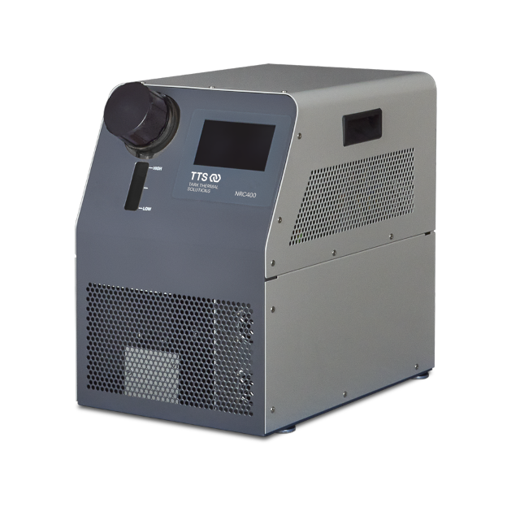
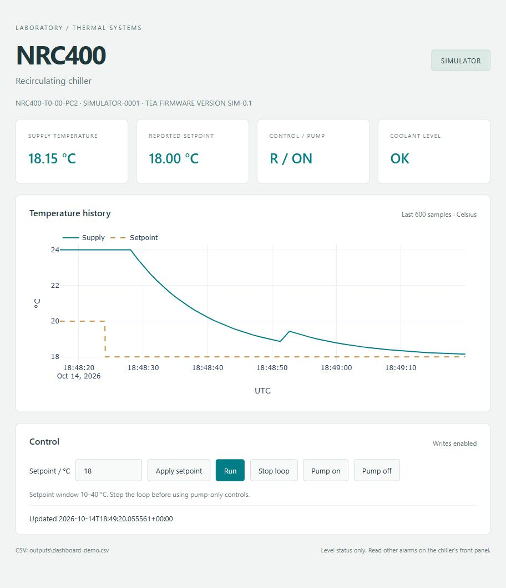

# NRC400 chiller controller

Python API, CLI, serial simulator, CSV recorder and local Dash dashboard for the
Tark NRC400-T0-00-PC2. The actual NRC400 API, CSV and GUI have been exercised;
physical commissioning remains incomplete. The chiller's internal controller
performs thermal regulation. See the [hardware results](docs/hardware-session-2026-10-14.md).



Product photo: [Tark Thermal Solutions](https://tark-solutions.com/products/thermoelectric-cooler-assemblies/nextreme-thermoelectric-chillers).

## Install and try

Python 3.11+, Windows PowerShell (Linux/macOS: use `.venv/bin/python`):

```powershell
python -m venv .venv
$nrcPython = ".\.venv\Scripts\python"
& $nrcPython -m pip install -c requirements-tested.txt ".[gui]"
& $nrcPython -m tark_nrc --simulate read
& $nrcPython -m tark_nrc --simulate log --duration 5 --csv outputs/demo.csv
& $nrcPython -m tark_nrc --simulate --allow-writes gui
```

Open <http://127.0.0.1:8050>, apply a target and press Run. Each process has its own
simulation (12 s first-order response, 24 °C idle; not measured performance).
CSV recording requires a new filename on every run.



GUI shown in simulator mode; these are not physical equipment measurements.

## Hardware and control

Follow [commissioning](docs/commissioning.md), copy `config.example.toml` to
`config.toml`, enter the verified port and begin with `allow_writes = false`.
Hardware selection never falls back to simulation.
Bind `control.expected_serial_number` when the exact unit is known. The local
`config.toml` on the tested PC selects COM7 / s26270058, a 12–20 °C window and
explicit optional-reply mode; it starts read-only and is excluded from Git.
Other units require their own verified framing, write behavior and limits.

```powershell
$nrcPython = ".\.venv\Scripts\python"
& $nrcPython -m tark_nrc ports
& $nrcPython -m serial.tools.list_ports -v
& $nrcPython -m tark_nrc --config config.toml identify
& $nrcPython -m tark_nrc --config config.toml read
& $nrcPython -m tark_nrc --config config.toml gui --csv outputs/first-read.csv
& $nrcPython -m tark_nrc --config config.toml --allow-writes set 20
& $nrcPython -m tark_nrc --config config.toml --allow-writes run
& $nrcPython -m tark_nrc --config config.toml --allow-writes stop
& $nrcPython -m tark_nrc --config config.toml --allow-writes pump off
```

API/CLI temperatures are Celsius; default limits are 10–40 °C. Verify coolant/
firmware before expanding them. Controls verify readback; Stop affects the loop,
with separate pump control. Disconnect/close retains equipment state; no retries.
Every public setting method queries and validates its own readback. This applies
to target, Run/Stop, pump, display units and time; an acknowledgement alone is
insufficient. A failed or interrupted write/readback locks further API writes until
you inspect the panel and explicitly close/reconnect. See the
[command verification table](docs/protocol.md#transactions-and-evidence).

## Python and CLI

Follow the [hardware API tutorials](examples/README.md) for four plain scripts
grouped by theme using your `config.toml`, or:

```python
from tark_nrc.config import create_chiller

with create_chiller("config.toml", allow_writes=True) as chiller:
    print(chiller.identity, chiller.read_sample())
    chiller.set_setpoint(20.0)
    chiller.run()
    # Perform the experiment; choose shutdown according to its needs.
    chiller.stop()
    chiller.set_pump(False)
```

Methods: `connect`, `close`, `query`, `read_temperature`, `read_setpoint`,
`read_sample`, `set_setpoint`, `run`, `stop`, `set_pump`, `set_units`, `set_time`.
CLI commands: `ports`, `identify`, `read`, `query CODE`, `set CELSIUS`, `run`,
`stop`, `pump on|off`, `units C|F`, `time HH:MM:SS`, `log`, `gui`; use `--help`.

Imports open nothing; one locked connection owns access. Avoid competing serial
programs/manual unit changes. Samples are sequential, timestamped afterward, with
SCF checked twice. The dashboard keeps 600 samples, optional CSV, and stops on
device/disk failure; investigate before restarting. It runs on localhost in one
process/thread without debug/reloader. No external PID, background service/database,
unattended fault handling, multiuser control or ramps are included.
The target input starts from actual readback and follows panel changes while
unedited; polling preserves a draft, including a cleared input. Apply replaces
the draft with the verified device value. Rejected input still refreshes current
state so Stop stays available. Each successful GUI action is checked against a
subsequent complete sample; drift locks the session without repeating its write.
Explicit controls take priority over a simultaneous polling tick. Stop/Pump off
take priority when several controls arrive together; conflicting activation
requests are rejected without writes.
CSV failure retains verified telemetry but locks the session and reports the error.
Controls stay disabled until valid telemetry arrives or when the selected action conflicts with the reported
loop/pump state. After a fault, activation and setpoint changes remain locked;
explicit operator Stop loop/Pump off may reconnect, reidentify the bound unit,
send the requested deactivation once, and verify readback. Restart before other
actions. Use the panel if communication fails. Serial ON/R is not proof of actual
circulation or cooling.

## Reference and checks

- [Protocol, command audit and unresolved firmware details](docs/protocol.md)
- [Installation and physical acceptance](docs/commissioning.md)
- [Software validation](docs/validation.md) and [source provenance](docs/sources/README.md)
- [Code map and development workflow](docs/development.md)

Install `".[gui,dev]"` for development, then run:

```powershell
$nrcPython = ".\.venv\Scripts\python"
& $nrcPython -m pytest
& $nrcPython -m ruff check src tests examples
& $nrcPython -m ruff format --check src tests examples
& $nrcPython -m build
```
